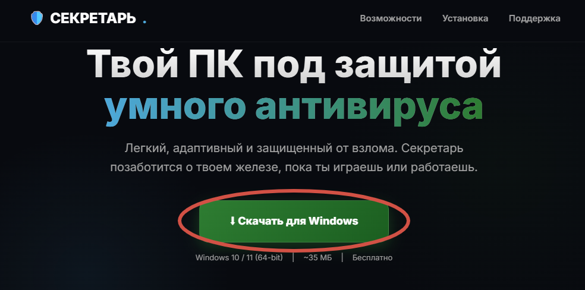

  
  <h1>🛡️ Секретарь Defender</h1>
  
<b>Легкий, умный и бесплатный антивирус для Windows, который уважает вашу приватность.</b>

  

    
    
    
    
    
  

  
  <h3><a href="https://utuberdzeff186-arch.github.io/secretary-site/">🌐 Посетить официальный сайт проекта</a></h3>

---

## 📖 О проекте

**Секретарь** — это независимый проект, созданный для защиты вашего ПК без навязчивой рекламы, тяжелых фоновых процессов и сбора личных данных. 

В отличие от популярных антивирусов, «Секретарь» работает **полностью локально**. Мы считаем, что защита не должна требовать передачи ваших файлов на сторонние серверы.

## ⚠️ Важно: Лицензия и Исходный код

Исходный код сайта и программы **доступен для публичного просмотра** (чтобы вы могли убедиться в отсутствии вредоносного кода), но **запрещен к использованию, копированию или модификации**. 
Подробнее смотрите в файле [LICENSE](./LICENSE).

## ✨ Главные особенности

*   🚀 **Минимальная нагрузка:** Программа потребляет минимум оперативной памяти и ресурсов процессора (IDLE).
*   🔒 **Самозащита (Anti-Kill):** Два процесса следят друг за другом. Если вирус попытается отключить антивирус, сторожевой процесс мгновенно его перезапустит.
*   🛡️ **Умная эвристика:** Поиск не только известных угроз, но и анализ подозрительного поведения программ.
*   🎭 **Живой маскот:** Встроенный интерактивный помощник, который следит за безопасностью и реагирует на события.

## 🗺️ Планы развития (Roadmap)

- [x] Разработка ядра v8.0 - v9.0
- [ ] **Разработка и релиз v9.3** *(В процессе)*
- [ ] Открытое бета-тестирование программы
- [ ] Защита от шифровальщиков (Ransomware Protection)
- [ ] Версия для Android / macOS

## 🐞 Нашли ошибку?

Если вы нашли баг на сайте или у вас есть идея по улучшению:
1. Перейдите в раздел [Issues](https://github.com/utuberdzeff186-arch/secretary-site/issues).
2. Создайте новый Issue.
3. Опишите проблему или предложение.

  
© 2026 Секретарь Defender Project. Все права защищены.

